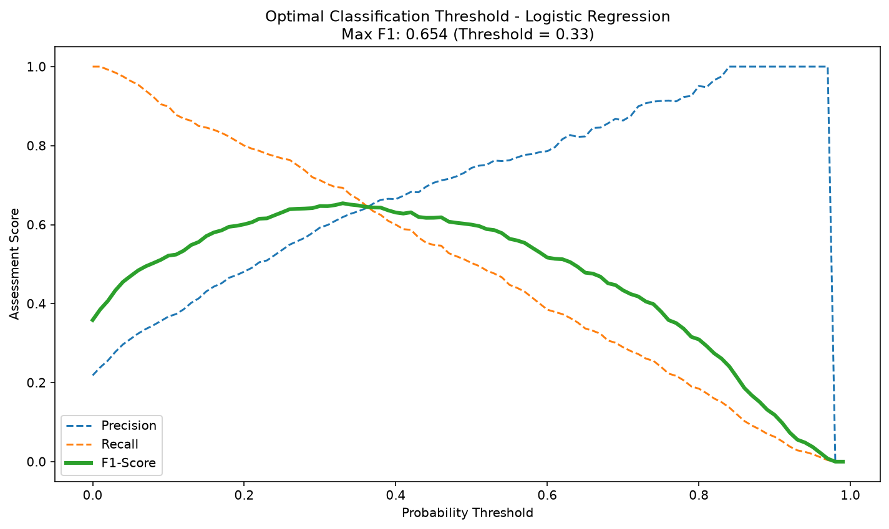
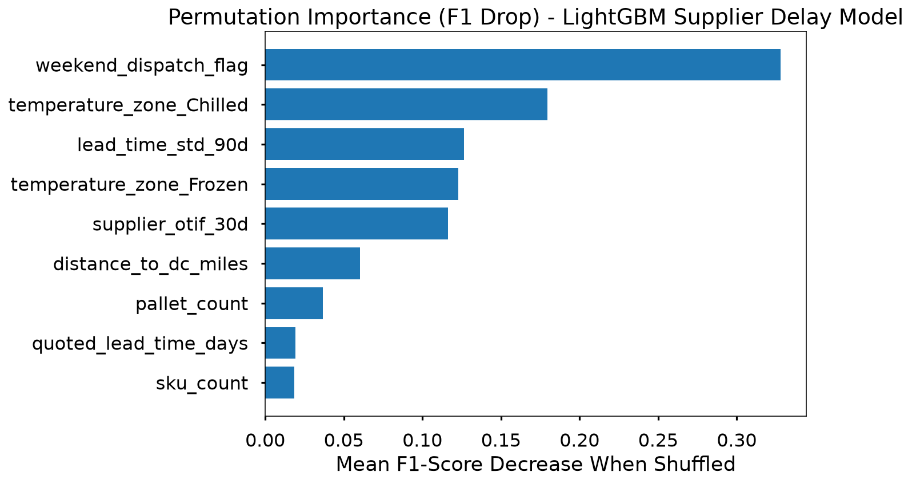

Our client, a grocery retailer, wants to identify high-risk purchase orders before dispatch to prevent fresh-category stockouts and reduce emergency freight costs.

### Table of contents
* [00. Project Overview](#00-project-overview)
  * [Context](#context)
  * [Actions](#actions)
  * [Results](#results)
  * [Growth/Next Steps](#growthnext-steps)
* [01. Data Overview](#01-data-overview)
* [02. Modelling Overview](#02-modelling-overview)
* [03. Logistic Regression](#03-logistic-regression)
* [04. Decision Tree](#04-decision-tree)
* [05. Random Forest](#05-random-forest)
* [06. LightGBM](#06-lightgbm)
* [07. Modelling Summary](#07-modelling-summary)
* [08. Application](#08-application)
* [09. Growth & Next Steps](#09-growth--next-steps)

---

### 00. Project Overview

##### Context
Our client, ABC Grocery, relies on hundreds of regional and national suppliers to replenish chilled, frozen, and ambient stock across its distribution centres (DCs). When an inbound supplier delivery misses its Service Level Agreement (SLA) window, planners are forced into costly emergency spot-buying or face empty store shelves—particularly in short-shelf-life fresh categories.

Currently, inventory planners apply static safety-stock buffers across all open Purchase Orders (POs), treating reliable suppliers the same as high-risk shipments. Based on historical PO, supplier, and carrier records from the client database, we look to predict the probability of an inbound order arriving late (`late_delivery_flag`). This allows procurement and inventory teams to intervene proactively before stockouts occur.

##### Actions
We compiled historical order-level records from the `purchase_orders`, `supplier_profiles`, and `carrier_logs` tables in the client database, capturing operational features including rolling 30-day supplier OTIF (On-Time In-Full) rates, 90-day lead-time variability, pallet volume, cold-chain temperature zones, and weekend dispatch flags.

Within our historical dataset, **78% of purchase orders arrived on time and 22% arrived late**. Because the target class is imbalanced, relying on Classification Accuracy alone would be misleading; we therefore evaluated all models across **Precision, Recall, and F1-Score**.

As we are predicting a binary operational outcome (`1` = Late, `0` = On-Time), we tested and compared four classification algorithms:
* Logistic Regression
* Decision Tree
* Random Forest
* LightGBM

For each approach, we applied algorithm-appropriate preprocessing (missing-value removal, outlier handling, one-hot encoding, and feature scaling where required), tuned key hyperparameters, and evaluated performance on a stratified unseen test set.

##### Results
Our primary objective was to catch as many genuinely late deliveries as possible (high **Recall**) without overwhelming planners with false alarms that inflate holding costs (strong **Precision**), making **F1-Score** our primary selection metric.

**Random Forest** delivered the strongest overall balance on the test set, achieving an **F1-Score of 0.721** (**Recall: 0.674**, **Precision: 0.775**, **Classification Accuracy: 0.886**), outperforming LightGBM (F1: 0.713), Decision Tree (F1: 0.695), and Logistic Regression (F1: 0.654 at optimal threshold). Permutation importance revealed that *weekend dispatch flags*, *chilled and frozen cold-chain requirements*, *90-day lead-time standard deviation*, and *rolling 30-day supplier OTIF* were the strongest predictors of inbound delays.

**Metric 1: Classification Accuracy**
* Decision Tree = 0.889
* Random Forest = 0.886
* LightGBM = 0.885
* Logistic Regression = 0.854 (default threshold)

**Metric 2: Precision**
* Decision Tree = 0.864
* LightGBM = 0.782
* Random Forest = 0.775
* Logistic Regression = 0.744 (default threshold)

**Metric 3: Recall**
* Random Forest = 0.674
* LightGBM = 0.655
* Decision Tree = 0.581
* Logistic Regression = 0.503 (default threshold)

**Metric 4: F1-Score**
* Random Forest = 0.721
* LightGBM = 0.713
* Decision Tree = 0.695
* Logistic Regression = 0.654 (at threshold = 0.33)

##### Growth/Next Steps
* Integrate external data feeds—specifically Met Office severe weather alerts, port congestion indicators, and motorway disruption logs—to improve early-warning lead times on long-haul routes.
* Replace uniform F1 threshold selection with a **cost-weighted expected loss function** that explicitly balances the cost of carrying extra safety stock against the margin loss of an out-of-stock SKU.
* Extend the pipeline with a second-stage regression or survival model to estimate *expected delay hours* for POs flagged as high risk.

---

### 01. Data Overview

We will be predicting the binary `late_delivery_flag` metric (`1` if received past the promised SLA window, `0` if on-time) from the `purchase_orders` table in the client database, enriched with supplier performance metrics from `supplier_profiles` and route metadata from `carrier_logs`.

In the code below, we:
* Import the required Python libraries
* Load and join the `purchase_orders`, `supplier_profiles`, and `carrier_logs` tables
* Inspect the class balance of `late_delivery_flag`
* Save the prepared modelling dataset as a pickle file for consistent reuse across algorithms

```python
# import required packages
import pandas as pd
import pickle

# import tables from database
purchase_orders = pd.read_csv("data/purchase_orders.csv")
supplier_profiles = pd.read_csv("data/supplier_profiles.csv")
carrier_logs = pd.read_csv("data/carrier_logs.csv")

# merge purchase orders with supplier and carrier tables
data_for_model = pd.merge(purchase_orders, supplier_profiles, how="inner", on="supplier_id")
data_for_model = pd.merge(data_for_model, carrier_logs, how="inner", on="po_id")

# check class balance of target variable
print(data_for_model["late_delivery_flag"].value_counts(normalize=True))
# >> 0    0.78
# >> 1    0.22

# save prepared dataset
pickle.dump(data_for_model, open("data/supplier_delivery_modelling.p", "wb"))
```

After data preparation, our modelling dataset contains 12,400 historical purchase orders across the following fields:

| Variable Name | Variable Type | Description |
| :--- | :--- | :--- |
| `po_id` | Identifier | Unique purchase order ID (dropped prior to modelling) |
| `late_delivery_flag` | Dependent | Binary target: `1` if delivered past SLA window, `0` if on-time |
| `supplier_otif_30d` | Independent | Supplier's On-Time In-Full rate over the prior 30 days (0.0 to 1.0) |
| `quoted_lead_time_days` | Independent | Contracted lead time between PO creation and scheduled DC arrival |
| `lead_time_std_90d` | Independent | Standard deviation (in days) of the supplier's actual lead times over 90 days |
| `pallet_count` | Independent | Total number of pallets on the purchase order |
| `sku_count` | Independent | Number of distinct SKUs included in the shipment |
| `distance_to_dc_miles` | Independent | Transit distance in miles from supplier depot to receiving DC |
| `temperature_zone` | Independent | Cold-chain requirement (`Ambient`, `Chilled`, `Frozen`) |
| `weekend_dispatch_flag` | Independent | Binary flag (`1`/`0`) indicating whether dispatch falls on Friday PM–Sunday |

A sample of the first 5 rows is shown below:

| late_delivery_flag | supplier_otif_30d | quoted_lead_time_days | lead_time_std_90d | pallet_count | sku_count | distance_to_dc_miles | temperature_zone | weekend_dispatch_flag |
| :---: | :---: | :---: | :---: | :---: | :---: | :---: | :---: | :---: |
| 0 | 0.96 | 3 | 0.42 | 14 | 8 | 64.5 | Chilled | 0 |
| 1 | 0.71 | 5 | 2.15 | 26 | 19 | 218.0 | Ambient | 1 |
| 0 | 0.92 | 2 | 0.55 | 8 | 4 | 41.2 | Chilled | 0 |
| 1 | 0.78 | 4 | 1.80 | 22 | 15 | 185.4 | Frozen | 1 |
| 0 | 0.95 | 3 | 0.38 | 12 | 6 | 92.0 | Ambient | 0 |

---

### 02. Modelling Overview

We want to build a model that accurately predicts `late_delivery_flag` before a shipment leaves the supplier's depot. Once trained and validated, this model can score all open purchase orders each morning so inventory controllers can adjust store safety buffers or trigger contingency sourcing.

Because **78% of orders are on-time (`0`) and 22% are late (`1`)**, a naive model predicting "on-time" for every shipment would achieve 78% accuracy while catching zero late deliveries. To evaluate models realistically, we track four metrics across every experiment:
* **Classification Accuracy:** Overall proportion of correctly classified purchase orders.
* **Precision:** Of all POs predicted as late, what proportion actually arrived late? (Controls unnecessary expediting and safety-stock holding costs.)
* **Recall:** Of all POs that actually arrived late, what proportion did we successfully flag in advance? (Controls stockout prevention.)
* **F1-Score:** The harmonic mean of Precision and Recall, balancing missed late deliveries against false alarms.

---

### 03. Logistic Regression

We begin with **Logistic Regression** as an interpretable linear baseline. Because linear models are sensitive to missing values, extreme outliers, and categorical text strings, we apply targeted preprocessing before fitting.

##### Data Import & Preprocessing

```python
# import required packages
import pandas as pd
import numpy as np
import pickle
import matplotlib.pyplot as plt
from sklearn.linear_model import LogisticRegression
from sklearn.utils import shuffle
from sklearn.model_selection import train_test_split
from sklearn.preprocessing import OneHotEncoder, StandardScaler
from sklearn.metrics import accuracy_score, precision_score, recall_score, f1_score

# import modelling data
data_for_model = pickle.load(open("data/supplier_delivery_modelling.p", "rb"))

# drop identifier columns and shuffle
data_for_model.drop(["po_id", "supplier_id"], axis=1, inplace=True)
data_for_model = shuffle(data_for_model, random_state=42)

# remove rows with missing values (<0.5% of records)
data_for_model.dropna(how="any", inplace=True)
```

###### Outlier Investigation
Using `.describe()`, we inspect the spread of our numeric features to check for extreme values—such as rare multi-drop bulk shipments in `pallet_count` or long-distance haulage in `distance_to_dc_miles`—that could distort linear coefficients. We apply the interquartile range (`2 * IQR`) rule to remove extreme numeric outliers before splitting our data.

```python
outlier_columns = ["pallet_count", "sku_count", "distance_to_dc_miles", "lead_time_std_90d"]

for column in outlier_columns:
    lower_quartile = data_for_model[column].quantile(0.25)
    upper_quartile = data_for_model[column].quantile(0.75)
    iqr = upper_quartile - lower_quartile
    min_border = lower_quartile - (iqr * 2)
    max_border = upper_quartile + (iqr * 2)
    outliers = data_for_model[(data_for_model[column] < min_border) | (data_for_model[column] > max_border)].index
    data_for_model.drop(outliers, inplace=True)
```

###### Train/Test Split, One-Hot Encoding & Feature Scaling
We use a stratified 80/20 train-test split so both sets retain the exact 78:22 class ratio. We fit `OneHotEncoder(drop="first")` on `temperature_zone` and `StandardScaler` on numeric features using `X_train` only, preventing data leakage into `X_test`.

```python
# split into X and y
X = data_for_model.drop(["late_delivery_flag"], axis=1)
y = data_for_model["late_delivery_flag"]

X_train, X_test, y_train, y_test = train_test_split(
    X, y, test_size=0.2, random_state=42, stratify=y
)

# one-hot encode categorical variables
categorical_vars = ["temperature_zone"]
one_hot_encoder = OneHotEncoder(sparse_output=False, drop="first")

X_train_encoded = pd.DataFrame(
    one_hot_encoder.fit_transform(X_train[categorical_vars]),
    columns=one_hot_encoder.get_feature_names_out(categorical_vars)
)
X_test_encoded = pd.DataFrame(
    one_hot_encoder.transform(X_test[categorical_vars]),
    columns=one_hot_encoder.get_feature_names_out(categorical_vars)
)

X_train = pd.concat([X_train.drop(categorical_vars, axis=1).reset_index(drop=True), X_train_encoded], axis=1)
X_test = pd.concat([X_test.drop(categorical_vars, axis=1).reset_index(drop=True), X_test_encoded], axis=1)

# standardise features for Logistic Regression
scaler = StandardScaler()
X_train_scaled = scaler.fit_transform(X_train)
X_test_scaled = scaler.transform(X_test)
```

##### Model Training & Optimal Threshold Analysis

```python
# train baseline Logistic Regression
clf = LogisticRegression(random_state=42, max_iter=1000)
clf.fit(X_train_scaled, y_train)

y_pred_class = clf.predict(X_test_scaled)
y_pred_prob = clf.predict_proba(X_test_scaled)[:, 1]

print(f"Default (0.50) -> Accuracy: {accuracy_score(y_test, y_pred_class):.3f}, "
      f"Precision: {precision_score(y_test, y_pred_class):.3f}, "
      f"Recall: {recall_score(y_test, y_pred_class):.3f}, "
      f"F1: {f1_score(y_test, y_pred_class):.3f}")
# >> Default (0.50) -> Accuracy: 0.854, Precision: 0.744, Recall: 0.503, F1: 0.600
```

At the default probability threshold of `0.50`, Recall is only **0.503**—meaning nearly half of late deliveries slip through unflagged. By sweeping thresholds from `0.00` to `1.00`, we find the probability cutoff that maximises F1-Score:

```python
thresholds = np.arange(0, 1, 0.01)
precision_scores, recall_scores, f1_scores = [], [], []

for threshold in thresholds:
    pred_class = (y_pred_prob >= threshold).astype(int)
    precision_scores.append(precision_score(y_test, pred_class, zero_division=0))
    recall_scores.append(recall_score(y_test, pred_class, zero_division=0))
    f1_scores.append(f1_score(y_test, pred_class, zero_division=0))

max_f1 = max(f1_scores)
optimal_threshold = thresholds[f1_scores.index(max_f1)]

plt.figure(figsize=(10, 6))
plt.plot(thresholds, precision_scores, label="Precision", linestyle="--")
plt.plot(thresholds, recall_scores, label="Recall", linestyle="--")
plt.plot(thresholds, f1_scores, label="F1-Score", linewidth=3)
plt.title(f"Optimal Classification Threshold - Logistic Regression\nMax F1: {max_f1:.3f} (Threshold = {optimal_threshold:.2f})")
plt.xlabel("Probability Threshold")
plt.ylabel("Assessment Score")
plt.legend(loc="lower left")
plt.tight_layout()
plt.show()
```



Lowering the classification threshold from the default `0.50` to **0.33** lifts Recall from `0.503` to roughly **0.69** and increases F1-Score to **0.654** (with Precision around **0.62**). However, linear decision boundaries still struggle to capture non-linear operational interactions—such as a chilled or frozen shipment dispatched over a weekend by a high-variance supplier—motivating tree-based models.

---

### 04. Decision Tree

Tree-based models handle non-linear interactions natively and do not require feature scaling. Here we test a **Decision Tree Classifier** and regularise `max_depth` to prevent overfitting on the training data.

```python
from sklearn.tree import DecisionTreeClassifier

# search for optimal max_depth using F1-Score
max_depth_list = list(range(1, 15))
f1_depth_scores = []

for depth in max_depth_list:
    clf_dt = DecisionTreeClassifier(max_depth=depth, random_state=42)
    clf_dt.fit(X_train, y_train)
    y_pred = clf_dt.predict(X_test)
    f1_depth_scores.append(f1_score(y_test, y_pred))

optimal_depth = max_depth_list[f1_depth_scores.index(max(f1_depth_scores))]
print(f"Optimal Max Depth: {optimal_depth} (F1-Score: {max(f1_depth_scores):.3f})")
# >> Optimal Max Depth: 6 (F1-Score: 0.695)

# re-fit regularised Decision Tree
clf_dt = DecisionTreeClassifier(max_depth=6, random_state=42)
clf_dt.fit(X_train, y_train)
y_pred_dt = clf_dt.predict(X_test)

print(f"Accuracy: {accuracy_score(y_test, y_pred_dt):.3f}, "
      f"Precision: {precision_score(y_test, y_pred_dt):.3f}, "
      f"Recall: {recall_score(y_test, y_pred_dt):.3f}, "
      f"F1: {f1_score(y_test, y_pred_dt):.3f}")
# >> Accuracy: 0.889, Precision: 0.864, Recall: 0.581, F1: 0.695
```

Regularising the tree at `max_depth = 6` raises F1-Score to **0.695** and delivers the highest Precision (**0.864**) and Classification Accuracy (**0.889**) of any individual model. However, Recall sits at **0.581**, meaning over 40% of delayed purchase orders still go unflagged.

---

### 05. Random Forest

To reduce variance and capture richer combinations of supplier reliability, cold-chain requirements, and transit distance, we next train an ensemble **Random Forest Classifier** with 500 trees.

```python
from sklearn.ensemble import RandomForestClassifier

clf_rf = RandomForestClassifier(
    n_estimators=500,
    max_features=5,
    random_state=42,
    n_jobs=-1
)
clf_rf.fit(X_train, y_train)
y_pred_rf = clf_rf.predict(X_test)

print(f"Accuracy: {accuracy_score(y_test, y_pred_rf):.3f}, "
      f"Precision: {precision_score(y_test, y_pred_rf):.3f}, "
      f"Recall: {recall_score(y_test, y_pred_rf):.3f}, "
      f"F1: {f1_score(y_test, y_pred_rf):.3f}")
# >> Accuracy: 0.886, Precision: 0.775, Recall: 0.674, F1: 0.721
```

Averaging across 500 decorrelated trees lifts **Recall by over 9 percentage points to 0.674** while maintaining strong **Precision (0.775)**, achieving our highest overall **F1-Score of 0.721**.

---

### 06. LightGBM

Finally, we test **LightGBM**, a gradient-boosted decision tree framework that builds trees sequentially—each new tree focusing specifically on the borderline purchase orders misclassified by prior trees.

```python
from lightgbm import LGBMClassifier
from sklearn.inspection import permutation_importance

clf_lgbm = LGBMClassifier(
    n_estimators=300,
    learning_rate=0.05,
    max_depth=6,
    num_leaves=31,
    subsample_for_bin=50000,
    random_state=42,
    verbose=-1
)
clf_lgbm.fit(X_train, y_train)

y_pred_lgbm = clf_lgbm.predict(X_test)
y_prob_lgbm = clf_lgbm.predict_proba(X_test)[:, 1]

print(f"Accuracy: {accuracy_score(y_test, y_pred_lgbm):.3f}, "
      f"Precision: {precision_score(y_test, y_pred_lgbm):.3f}, "
      f"Recall: {recall_score(y_test, y_pred_lgbm):.3f}, "
      f"F1: {f1_score(y_test, y_pred_lgbm):.3f}")
# >> Accuracy: 0.885, Precision: 0.782, Recall: 0.655, F1: 0.713
```

##### Permutation Importance (Key Operational Drivers)
To ensure supply chain managers can trust and act on the model's alerts, we compute **Permutation Importance** on the unseen test set to measure how much F1-Score drops when each feature's values are randomly shuffled:

```python
perm_result = permutation_importance(
    clf_lgbm, X_test, y_test, n_repeats=10, scoring="f1", random_state=42
)

perm_summary = pd.DataFrame({
    "feature": X_test.columns,
    "importance_mean": perm_result.importances_mean
}).sort_values(by="importance_mean", ascending=True)

plt.figure(figsize=(10, 6))
plt.barh(perm_summary["feature"], perm_summary["importance_mean"])
plt.title("Permutation Importance (F1 Drop) - LightGBM Supplier Delay Model")
plt.xlabel("Mean F1-Score Decrease When Shuffled")
plt.tight_layout()
plt.show()
```



The top operational drivers of inbound delays identified by Permutation Importance are:
1. **`weekend_dispatch_flag` & Cold-Chain Zones (`Chilled` / `Frozen`):** Orders dispatched on Friday afternoons or weekends—especially temperature-controlled loads—cause the steepest F1-Score drops (~0.33 for weekend dispatch, ~0.18 for `Chilled`, and ~0.12 for `Frozen`) due to tighter carrier handoff windows and limited weekend receiving capacity.
2. **`lead_time_std_90d`:** Suppliers with erratic historical transit times (~0.13 F1 drop) pose a substantial delay risk even when their quoted lead time appears acceptable.
3. **`supplier_otif_30d`:** Recent 30-day On-Time In-Full execution (~0.115 F1 drop) provides a strong ongoing signal of supplier reliability.

---

### 07. Modelling Summary

Comparing all four models on the unseen test set confirms a clear performance gain when moving from linear boundaries to tree-based ensembles:

| Model | Classification Accuracy | Precision | Recall | F1-Score |
| :--- | :---: | :---: | :---: | :---: |
| Logistic Regression (Default = 0.50) | 0.854 | 0.744 | 0.503 | 0.600 |
| Logistic Regression (Optimal = 0.33) | — | — | — | 0.654 |
| Decision Tree (`max_depth = 6`) | **0.889** | **0.864** | 0.581 | 0.695 |
| LightGBM | 0.885 | 0.782 | 0.655 | 0.713 |
| **Random Forest (`n_estimators = 500` — Selected)** | 0.886 | 0.775 | **0.674** | **0.721** |

We select **Random Forest** for deployment: it achieves the highest **F1-Score (0.721)** and **Recall (0.674)**—catching more than two-thirds of late purchase orders in advance while keeping nearly 4 out of 5 flagged alerts accurate.

---

### 08. Application

We save our trained Random Forest classifier and fitted `OneHotEncoder` as serialised artifacts so the client's replenishment pipeline can score all open purchase orders every morning at 06:00 before carrier cutoffs.

```python
# save production artifacts
pickle.dump(clf_rf, open("models/rf_late_delivery_model.p", "wb"))
pickle.dump(one_hot_encoder, open("models/ohe_supplier_encoder.p", "wb"))

# --- Daily Morning Scoring Pipeline ---
open_pos = pd.read_csv("data/daily_open_purchase_orders.csv")
po_ids = open_pos["po_id"]
scoring_features = open_pos.drop(["po_id", "supplier_id"], axis=1)

# apply saved one-hot encoder (transform only)
encoded_cols = pd.DataFrame(
    one_hot_encoder.transform(scoring_features[["temperature_zone"]]),
    columns=one_hot_encoder.get_feature_names_out(["temperature_zone"])
)
scoring_ready = pd.concat(
    [scoring_features.drop(["temperature_zone"], axis=1).reset_index(drop=True), encoded_cols],
    axis=1
)

# generate late-delivery probabilities and operational action tiers
open_pos["late_delivery_prob"] = clf_rf.predict_proba(scoring_ready)[:, 1]
open_pos["risk_tier"] = np.select(
    [
        open_pos["late_delivery_prob"] >= 0.65,
        open_pos["late_delivery_prob"] >= 0.40
    ],
    [
        "High Risk - Expedite / Split PO",
        "Medium Risk - Increase Store Buffer"
    ],
    default="Low Risk - Standard Replenishment"
)
```

Rather than reviewing hundreds of open POs manually, inventory controllers receive a prioritised exception queue:
* **High Risk (`prob >= 0.65`):** Planners contact the carrier to confirm slot booking or split urgent fresh-produce volume to a secondary regional supplier.
* **Medium Risk (`0.40 <= prob < 0.65`):** Automated ERP parameters temporarily add +1 day of safety stock buffer at downstream stores.
* **Low Risk (`prob < 0.40`):** Processed via standard automated replenishment without manual intervention.

---

### 09. Growth & Next Steps

* **External Disruption Signals:** Enriching the feature set with live weather warnings, port dwell times, and major motorway incident feeds would capture sudden network shocks that historical supplier OTIF metrics cannot foresee.
* **Cost-Optimised Decision Thresholds:** Partnering with finance and commercial teams to assign exact pound-sterling penalties to stockouts versus expediting fees would allow us to tune probability cutoffs per product category (e.g., stricter Recall thresholds for short-life chilled berries than for tinned goods).
* **Delay Duration Estimation:** Pairing this binary classifier with a regression or survival model to estimate *how many hours late* a flagged PO will arrive would help warehouse managers dynamically reschedule inbound receiving dock labour.
